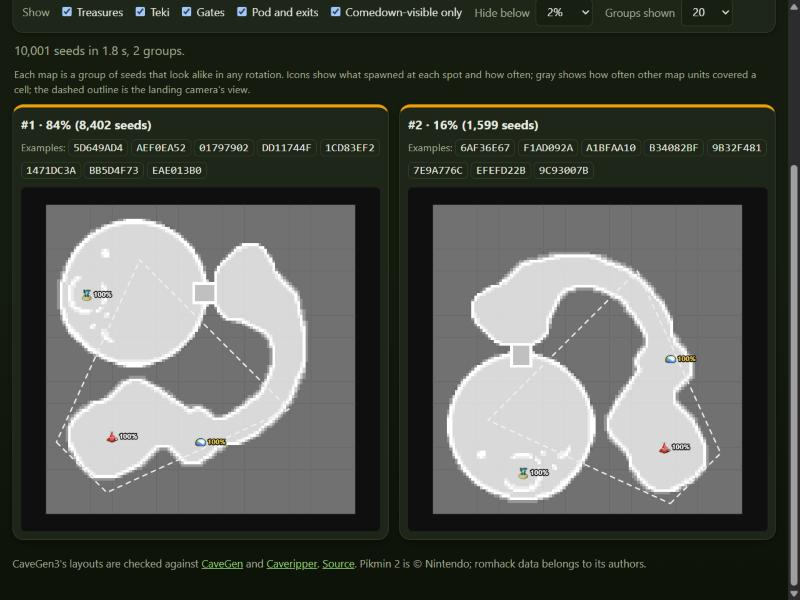
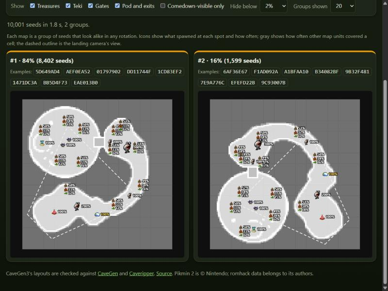
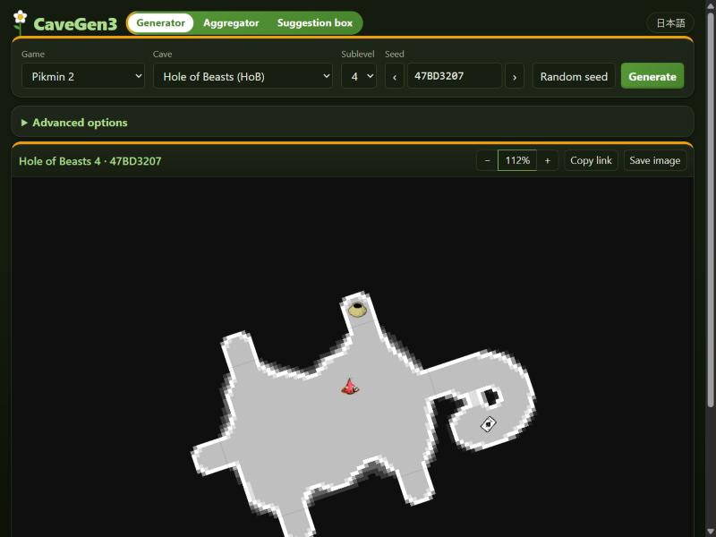

# What shows on the comedown

The comedown is the first frame of the cutscene that starts every cave floor,
`s0B_cv_coursein`, held while the sublevel's name is on screen (see the README's **Comedown
outline**). The **Comedown-visible only** option draws only what the game draws then.

## The answer

| Object | On the comedown? | Why |
| --- | --- | --- |
| Treasures | Yes | Pellets; the cutscene draws pellets. |
| Buried treasures | Yes, as their dirt mound | The pellet is drawn (sunk into the floor) and its mound is an item. A fully buried one shows only the mound. |
| Enemies (any kind) | No | The cutscene doesn't draw enemies. |
| Enemies that drop from the sky | No | Not drawn by the cutscene, and not drawn at all before they fall. |
| Enemies hiding underground | No | Not drawn by the cutscene, and hidden until they come up. |
| Treasures carried by enemies | No | The treasure is only a pellet after the enemy dies. |
| Plants, eggs, Candypop Buds | No | These are teki (enemies) too. |
| Gates | Yes | Items, which cutscenes don't hide. |
| Hole, geyser | Yes | Items. |
| Pod, Onions | Yes | Items; the pod is also in the cutscene itself. |
| Bridges | Yes (in principle) | Items, but no cave generates one. |
| Pikmin | Yes | The cutscene draws Pikmin; it's the ones falling with the pod. |
| Captains | No | The cutscene doesn't draw captains. |

So the option just leaves off every teki. Note that the cave is dark: on screen, only the floor
lit around the pod is easy to make out.

## Evidence

**The cutscene's draw flags (game files).** `/user/Mukki/movie/demos.txt` lists every cutscene.
The cave intro's entry:

```
# s0B_洞窟フロアーイン
	folder 	s0B_cv_coursein
	...
	1 	# flags
	5 6 	# pause/draw/fade flag
```

`MovieConfig::read` (pikmin2 decomp, `src/sysGCU/movieConfig.cpp`) reads these as `mFlags = 1`,
then `setDrawFlag(5)` and `mDrawType = 6`. The draw flags are `MVDP_DrawPikmin = 1`,
`MVDP_DrawEnemy = 2`, `MVDP_DrawPellet = 4` and `MVDP_DrawNavi = 8`
(`include/Game/MoviePlayer.h`). So 5 means Pikmin and pellets, but not enemies or captains. For
comparison, the overworld intros (`s00_coursein`) have 6, which does draw enemies.

**How the flags are used (decomp).**
- `MoviePlayer::setPauseAndDraw` (`src/sysGCU/moviePlayerPauseAndDraw.cpp`) passes each flag to
  its manager: `generalEnemyMgr->setMovieDraw(config->isDrawFlag(MVDP_DrawEnemy))`, and the same
  for pellets, Pikmin and captains.
- With the flag off, `GeneralEnemyMgr::setMovieDraw` sets `mDrawFlag |= 1`
  (`src/plugProjectYamashitaU/generalEnemyMgr.cpp`). `EnemyMgrBase` then skips drawing every
  enemy that isn't one of the cutscene's actors: `!(generalEnemyMgr->mDrawFlag & 1) ||
  enemy->isMovieActor()` (`enemyMgrBase.cpp`).
- Pellets check `!pelletMgr->mMovieDrawDisabled || isMovieActor()` (`pelletMgr.cpp`), and that's
  on here.
- A buried pellet (`mDepth > 0`) also makes an `ItemTreasure` mound (`pelletMgr.cpp`). Gates
  (`ItemGate`), the hole (`ItemHole`), the geyser (`ItemBigFountain`) and Onions (`ItemOnyon`) are
  items. `ItemMgr` has no cutscene switch; it draws them whenever they're in view (`itemMgr.cpp`).
- Enemies don't need any of this to be missing; they're all created when the floor loads, before
  the cutscene starts (`RoomMapMgr::placeObjects`, called from `baseGameSection.cpp`). Even
  without the flag, falling enemies wait in a `BirthTypeDrop` state, which never adds them to the
  draw list. Burrowed ones set `EB_ModelHidden` in their `StateStay` (e.g. the Burrowing Snagret
  in `SnakeCrowState.cpp`).
- Treasures held by enemies are made when the enemy dies (its drop items), so they aren't pellets
  yet.

**Run videos.** The frames come from the Pikmin 2 Layout Ledger's run videos, and the layouts
from CaveGen3 using each floor's recovered seed (`cavegen3 <sublevel> <seed> --view comedown
--screen 4:3`).
- Emergence Cave 1 (01_JackDraz, seed `63452B1B`): the first treasure, about 600 units ahead of
  the pod, shows plainly in the lit corridor during the comedown.
- Hole of Beasts 4 (01_JackDraz, seed `47BD3207`): CaveGen3 places a Red Bulborb (carrying the
  Dream Architect) right beside the pod, inside the lit circle, and Common Glowcaps around it.
  The comedown frames (brightened) show that floor lit and empty, and no glowcap lights. A couple
  of seconds later, after the cut to the landing, the Bulborb and the glowing glowcaps are there.

## Screenshots

The aggregator on Emergence Cave 2, with and without the option, and the main page's comedown
view of Hole of Beasts 4 (`?sublevel=pikmin2:HoB-4&seed=47BD3207&view=comedown&comedownVisible=1`):




