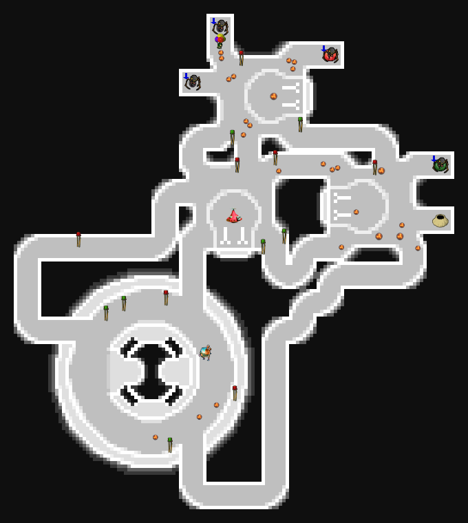
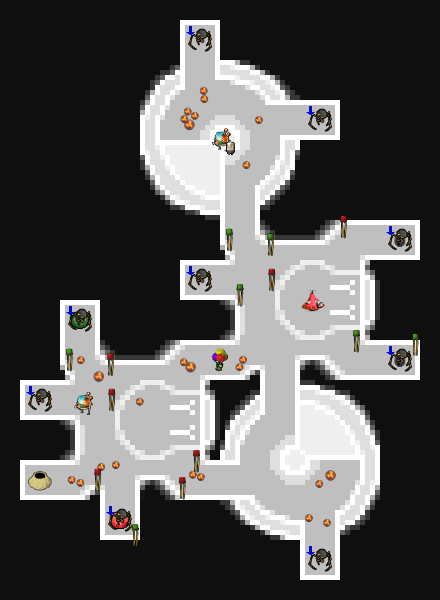

# Towerless Subterranean Complex 7

A claim going around: CaveGen3 shows "towerless" SCx-7 seeds about **1.2%** of the time on
GameCube/Wii and **0.8%** on Switch. It doesn't hold up. Both platforms come out at **1.30%**, and
the two rates agree to within 0.01 percentage points.

## What "towerless" means

SCx-7 has 4 rooms, drawn from three room units:

| Room | Doors | Notes |
|---|---|---|
| `room_ari1_3_metal` | 3 | the big 8x8 round room; can hold the pod |
| `room_hitode4x4_6_metal` | 6 | can hold the pod |
| `room_hitode4x4_tower_3_metal` | 3 | **the tower**: the floor's only special (group 8) spawn point, on top of the tower |

The caveinfo has two Gatling Groinks (MiniHoudai), each with a minimum of 1:
- an ordinary one (group 1, hard), which can spawn in any room;
- `FminiHoudai_sinkukan_b`, a stationary Gatling Groink in group 8 that carries the **Indomitable
  CPU**. It can only spawn on the tower.

**Towerless = the map has no `room_hitode4x4_tower_3_metal`.** The second Gatling Groink then has
nowhere to spawn, so the floor has one Gatling Groink and no Indomitable CPU. This is Caveripper's
own query for it, `scx7 minihoudai < 2`. CaveGen3 runs the same query in `tests/query_vs_reference.rs`,
on Caveripper's 10 towerless and 10 ordinary seeds.

`examples/towerless check` generates full layouts and checks that the three definitions are the
same thing: no tower room, fewer than 2 Gatling Groinks, and no Indomitable CPU. They matched on
all 40,000 layouts checked (20,000 GC and 20,000 Switch).

| Towerless, GC seed 14FD6FDA | Has a tower, GC seed 42AC4C0F |
|---|---|
|  |  |

## The rates

`cargo run --release -p cavegen3 --example towerless -- random <rng> 4000000`, with Wilson 95%
intervals:

| Generator | Seeds | Towerless | Rate | 95% CI |
|---|---|---|---|---|
| GC/Wii, real LCG, random seeds | 4,000,000 | 52,087 | **1.302%** | 1.291–1.313% |
| Switch, real LCG, random 64-bit seeds | 4,000,000 | 52,037 | **1.301%** | 1.290–1.312% |
| GC arithmetic, ideal 15-bit `rand()` | 4,000,000 | 52,156 | 1.304% | 1.293–1.315% |
| Switch arithmetic, ideal 31-bit `rand()` | 4,000,000 | 52,140 | 1.304% | 1.292–1.315% |

The GC − Switch difference is +0.001 percentage points. Its 95% interval is ±0.016 points
(z = 0.16, p ≈ 0.87), so **there's no difference** that a sample this size can detect. The claimed
gap of 0.4 points would be 50 standard errors.

The page's other seed modes give the same rate (1,000,000 seeds each, all ±0.022 points):

| Seeds | GC | Switch |
|---|---|---|
| counting up from 0 (the web page's "c") | 1.299% | 1.305% |
| the game RNG stepped from 0 ("g") | 1.305% | 1.300% |
| random ("r") | 1.302% (above) | 1.301% (above) |

The CLI agrees: `cavegen3 stats SCx-7 "minihoudai < 2" -n 200000` gives 1.31–1.33% on GC in
every seed mode.

**Are the game's real seeds uniform?** A layout's seed is the RNG state when the floor starts
generating, after an unpredictable amount of play, so it lands anywhere on the generator's cycle.
Both LCGs have full period (2^32 on GC, 2^64 on Switch), so each state is equally likely. On GC,
the top bit of the state never reaches `rand()`'s output, so the 2^31 effective seeds are each
equally likely too.

## Why the rates are the same

### Where the tower decision happens

It's settled during map unit placement, before anything spawns
(`cargo run --release -p cavegen3 --example room_trace -- SCx-7 14FD6FDA` prints each step).

1. `mapUnitsInitialSorting` shuffles the room queue: 12 entries (3 rooms × 4 rotations), one
   `randInt(12)` per entry. The start room is the first entry with a pod spot, so it's never the
   tower.
2. SCx-7's corridor probability is 0, so until 4 rooms are placed, every step tries rooms first.
   Each step:
   - picks a random open door (`randInt(open doors)`);
   - rolls `randFloat` for the corridor check (always "room first" here);
   - goes down the room queue, shuffling each entry's doors (`randInt(doors)` per door), and
     places the first entry that fits.
3. After a room is placed, room names that aren't on the map yet keep their order at the front of
   the queue. Placed names go to the back (`randInt(4)` shuffles).

So until the tower is placed, its four rotations sit near the front of the queue, mixed in with
whichever other room hasn't been placed yet. The map is towerless if, at each of the 3 room
placements after the start, something earlier in the queue fits first, or no tower rotation fits
at the chosen door.

The tower often can't fit next to a 6-door room. Its 3 doors (north offset 1, south offset 2, west offset 2) don't line
up with the paired doors of `room_hitode4x4_6_metal` (two on the north side, two on the south). An
open door it can't meet would face into it, so the fit is rejected. On seed 14FD6FDA, at the first
step, all four tower rotations and all four `ari1` rotations fail at a north door of the start
room, and a second 6-door room goes in. The tower also fails at the doors picked in later steps.

All of this is door geometry and the order of a few small random choices. It's the same code on
both platforms.

### How Switch's `rand()` differs, and why it doesn't matter here

| | GC/Wii | Switch |
|---|---|---|
| LCG | 32-bit, `0x41C64E6D·s + 0x3039` | 64-bit (musl), `6364136223846793005·s + 1` |
| `rand()` | state bits 16–30: 15 bits, 0..32767 | state bits 33–63: 31 bits, 0..2^31−1 |
| `randInt(n)` | `(int)(rand() · (n / 32768.0f))` | `(int)(rand() · (n / 2^31))` in f32; the top 64 `rand()` values round up to `n`, which CaveGen3 clamps |

- **Resolution.** On GC, `randInt(n)` gives each of its `n` values either ⌊32768/n⌋ or ⌈32768/n⌉
  raw values. The bias is at most n/32768, about 0.04% relative for the largest `n` here (12 or
  13). It shifts a 1.3% rate by roughly 0.0005 points. On Switch the bias is about 2^−24.
- **The LCG's own patterns.** Low LCG bits are poor, but both games read only high bits. The
  controlled runs check whether this matters:
  - the real GC generator against the same arithmetic fed by an ideal 15-bit stream: 1.302% vs
    1.304%;
  - the real Switch generator against an ideal 31-bit stream: 1.301% vs 1.304%;
  - ideal 15-bit against ideal 31-bit, which isolates resolution: 1.304% vs 1.304%.

  None of the differences is more than a third of the noise, so neither the output resolution nor
  the generators' patterns move the tower odds.

The SR-7 study (`docs/SR7_MISSING_BOSS.md`) found the same for room placement there: the choices
are identical on both platforms, and Switch's finer numbers change each probability by about
1 part in 30,000.

## What the 1.2% / 0.8% likely came from

Something other than a large sample. The site's search and the CLI test **10,000 seeds** by
default. At that size the 95% margin is ±0.22 points, so 1.2% is a normal result for a true 1.30%.
0.8% would be 4.4 standard errors low at 10,000 seeds, but it's an ordinary result at about 1,000
seeds (8 hits where 13 are expected happens about 1 time in 10). Two small runs, one per platform,
explain the claim. Run 100,000 or more seeds before comparing rates of about 1%.

Note that the CLI's `stats`, `count` and `search` don't support `--rng switch` yet, so a Switch
rate had to come from the web page.

## Reproducing

```
cargo run --release -p cavegen3 --example towerless -- check gc 20000      # definition check
cargo run --release -p cavegen3 --example towerless -- random gc 4000000
cargo run --release -p cavegen3 --example towerless -- random switch 4000000
cargo run --release -p cavegen3 --example towerless -- random ideal-gc 4000000
cargo run --release -p cavegen3 --example towerless -- random ideal-switch 4000000
cargo run --release -p cavegen3 --example towerless -- random switch-count 1000000
cargo run --release -p cavegen3 --example towerless -- scan                # all 2^31 GC seeds
cargo run --release -p cavegen3 --example room_trace -- SCx-7 14FD6FDA
```

The real generators run about 12,000 seeds/s on a busy 8-core PC (about 30,000 when it's idle),
so 4M seeds take about 5 minutes. The full GC scan would take a day, and it isn't needed at this
precision.
