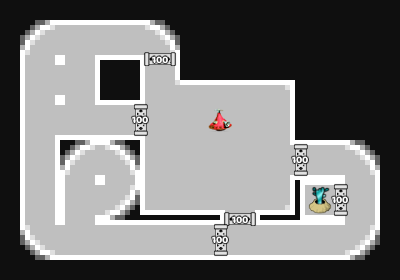

# Shower Room 7's missing boss

One GameCube seed of Shower Room 7 (SR-7) has no Ranging Bloyster: **0x31D70855**. A scan of all
2^31 seeds finds it and no other.



## Why the boss can't spawn

- SR-7 has one room unit, `room_4x4a_4_tile`, and it has one boss spawn point, in its center.
- The boss (special teki, group 8) needs a spawn point at least 300 units from the pod and at least
  150 from the geyser.
- The first room holds the pod, whose spots are 115 and 137 units from the center. So the boss can
  only go in the second room.
- The sublevel asks for 2 rooms. Room placement only stops early if every open door gets closed
  first, which leaves the map with 1 room and no boss.

## How the map closes on seed 31D70855

`cargo run --release -p cavegen3 --example room_trace -- SR-7 31D70855` prints every step.

While a room is still missing, each step picks a random open door. A room is tried first only when
the door is on a hallway and the 50% corridor roll fails. Doors on rooms always try a hallway first.

On this seed, the first 22 steps all grow hallways:
- A room would have fit at 1–4 of the 3–8 open doors.
- But each step either picked a door where it wouldn't fit, or rolled "hallway first".

The hallways wrap around the room. From step 23 on, no open door has space for a 4x4 room. The last
steps cap one door and join the rest with L-shaped hallways. Step 26 links the last two open doors,
and the map is done with one room.

## Odds

**GameCube: exactly 1 in 2^31** (1 in 2,147,483,648). This is an exact count: `examples/room_scan`
checks every seed and finds only 31D70855.

**Per seed, for an ideal random number generator: about 1 in 1.7×10^10** (5.9×10^-11 ± 1.2×10^-11).
`examples/room_odds` estimates this by multilevel splitting. Maps grow step by step from fresh
random states, and the ones that get closer to failing are kept and copied. The levels are:

| Level | Reached from the level before |
|---|---|
| A room fits at ≤3 open doors | 0.266 |
| … ≤2 | 0.120 |
| … ≤1 | 0.062 |
| … none | 0.024 |
| No room fits, and ≤4 doors open | 0.31 |
| … ≤3 | 0.050 |
| … ≤2 | 0.31 |
| … ≤1 (or closed) | 0.0052 |
| Closed | 0.051 |

The first levels agree with real GC seeds to within about 0.001 (`examples/room_levels`). The last
step is the rare one: with two doors left, a hallway usually grows outward again, and then a room
fits.

So all 2^31 GC seeds should give about 0.13 such maps. GameCube has one, which a GC-sized seed space
would show about 12% of the time. It is a lucky find, roughly 8 times rarer than "1 in 2^31"
suggests.

**Switch (Pikmin 2 HD): the same per seed.** `room_odds SR-7 switch 200000 32` gives 2.3×10^-11 ±
1.3×10^-11. The same-size GC run gives 5.3×10^-11 ± 2.5×10^-11, so the two agree within the
estimate's noise, and the first seven levels match to 2–3 digits.

This is expected. The choices are the same on Switch: a door, a 50% roll, shuffles. Its finer
random numbers change each probability by only about 1 part in 30,000. That gives:
- about 2^64 × 5.9×10^-11 ≈ **1.1 billion** Switch seeds with no Ranging Bloyster;
- one in about 1.7×10^10 random seeds, which is about 1.5 days for `room_scan` on an 8-core PC
  (about 140,000 seeds a second).

## Reproducing

```
cargo run --release -p cavegen3 --example room_scan -- SR-7                   # all GC seeds, ~4 h
cargo run --release -p cavegen3 --example room_trace -- SR-7 31D70855
cargo run --release -p cavegen3 --example room_odds -- SR-7 gc 400000 64
cargo run --release -p cavegen3 --example room_levels -- SR-7 1000000 gc
```
